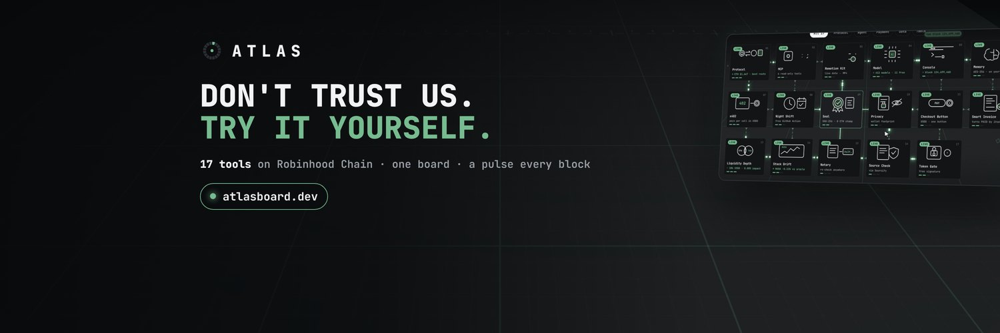
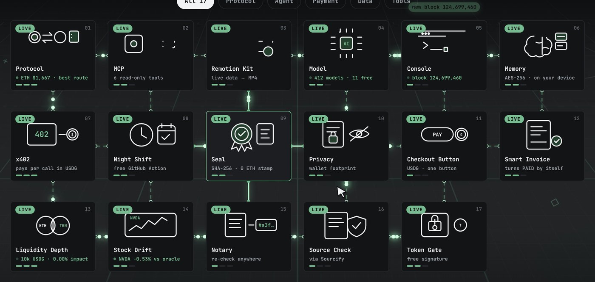
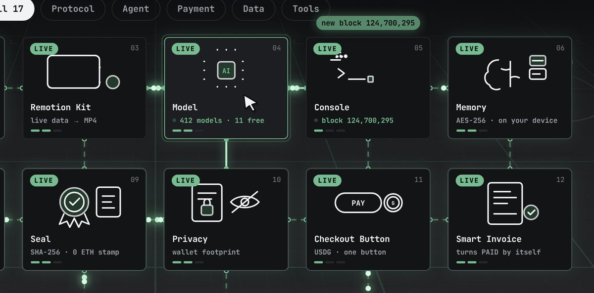
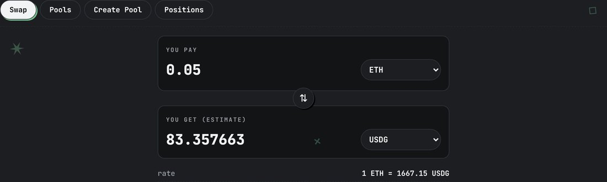
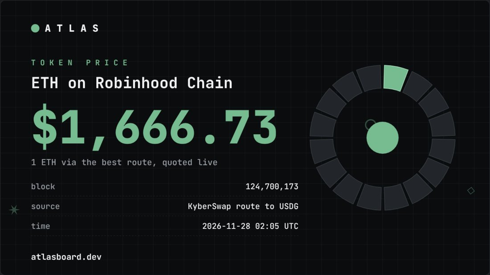
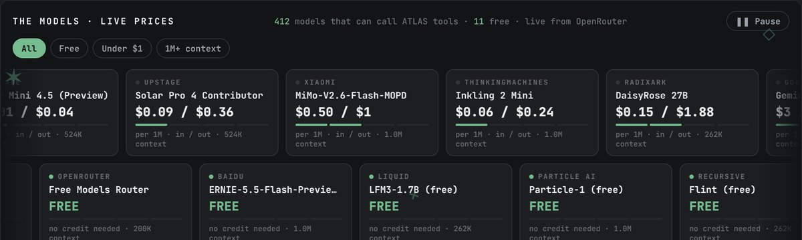

<p align="center"></p>

<h1 align="center">ATLAS</h1>

<p align="center"><b>17 tools for trading, liquidity, AI agents and payments on Robinhood Chain.</b><br>One board. Every tool runs on its own page, on mainnet, in your browser.</p>

<p align="center">
<a href="https://atlasboard.dev">atlasboard.dev</a> ·
<a href="https://x.com/atlasboard_">X @atlasboard_</a> ·
<a href="https://github.com/atlasboard/atlas-mcp">ATLAS MCP</a> ·
<a href="docs/ARCHITECTURE.md">How it works</a> ·
<a href="SECURITY.md">Security</a>
</p>

<p align="center">


</p>

---

## The board

<p align="center"></p>

The home page is a board of 17 squares joined by wires. It powers on as you arrive, and it has a heartbeat: every few seconds ATLAS asks Robinhood Chain for the latest block, and when a new one lands a pulse runs from Console through every tool. Some squares show live numbers (ETH price, the latest block, NVDA against its oracle, price impact on 10k USDG), refreshed from the chain every 30 seconds.

<p align="center"></p>

## All 17 tools are live

| Tool | What it does |
| --- | --- |
| [Protocol](https://atlasboard.dev/swap) | Four tabs: **Swap** any token at the best route; **Pools**, every Uniswap v4 pool for a token; **Create Pool**, start a pool or add full-range liquidity via the PositionManager and Permit2; **Positions**, what your liquidity holds, fees to collect, collect or remove. Exact amounts, simulated first, signed in your own wallet. |
| [MCP](https://atlasboard.dev/mcp) | Six read-only chain tools for Claude, Cursor and any MCP client: `npx -y github:atlasboard/atlas-mcp` |
| [Remotion Kit](https://atlasboard.dev/remotion-kit) | Turn live chain data (a price, a block, a stock drift, a transaction) into a video card: preview it in the browser, record a WebM, or download a Remotion project and render an MP4. Not affiliated with Remotion. |
| [Model](https://atlasboard.dev/model) | A live wall of 400+ models with their OpenRouter prices. Pick any of 400+ models; it answers from live chain data using ATLAS tools. Your own OpenRouter key, kept in the tab. |
| [Console](https://atlasboard.dev/console) | A command line for the chain: block, gas, balance, token, price, tx, verify, hash. |
| [Memory](https://atlasboard.dev/memory) | An encrypted memory vault on your device: folders, ChatGPT/Claude import, an approval inbox, per-folder sharing, read log. |
| [x402](https://atlasboard.dev/x402) | Open any x402 endpoint, read its price, pay in USDG by signing an EIP-3009 authorization in your wallet. |
| [Night Shift](https://atlasboard.dev/night-shift) | A free GitHub Action in your own repo that writes a chain report on schedule. |
| [Seal](https://atlasboard.dev/seal) | Hash a file on your device and stamp the fingerprint on chain from your own wallet. |
| [Privacy](https://atlasboard.dev/privacy) | What strangers can read about a wallet: counterparties, active hours, open approvals. |
| [Checkout Button](https://atlasboard.dev/checkout-button) | A USDG pay button for any website. |
| [Smart Invoice](https://atlasboard.dev/smart-invoice) | An invoice in a link that marks itself PAID when the USDG arrives. |
| [Liquidity Depth](https://atlasboard.dev/liquidity-depth) | Live router quotes from 100 to 50,000 USDG and the price impact of each. |
| [Stock Drift](https://atlasboard.dev/stock-drift) | Stock tokens on chain next to their oracle prices. |
| [Notary](https://atlasboard.dev/notary) | A certificate that a text or file was stamped at a given block. |
| [Source Check](https://atlasboard.dev/source-check) | Sourcify verification and every function that can change state. |
| [Token Gate](https://atlasboard.dev/token-gate) | Holders prove they hold a token with a free wallet signature; anyone can check the proof. |

<table><tr>
<td width="33%"><br><b>Protocol</b>: swap, pools, create a pool, positions</td>
<td width="33%"><br><b>Remotion Kit</b>: chain data to a video card</td>
<td width="33%"><br><b>Model</b>: 400+ AI models with live prices</td>
</tr></table>

## Tested with a real wallet

Before launch, every tool that writes to the chain was used once from a real wallet on mainnet: a swap both ways, liquidity added and removed, Seal, Notary, Smart Invoice, Checkout Button and Token Gate. Every approval was for the exact amount, and the allowance went back to zero after each. x402 is ready but waits for a live x402 endpoint on Robinhood Chain to test against.

## How it works

- One static page. No server, no database, no account, no tracking.
- Reads Robinhood Chain mainnet (chain 4663) from the public RPC, contracts from Sourcify, route quotes from KyberSwap and pools from the Uniswap v4 PoolManager, straight from your browser.
- Anything that sends money or writes to the chain is simulated first (`eth_call` and `eth_estimateGas`) and then signed in **your own wallet**. ATLAS never holds funds, keys or seed phrases.
- Liquidity goes through the Uniswap v4 PositionManager with Permit2, for the exact amounts only.
- Memory is encrypted on your device (AES-256-GCM, PBKDF2); the password and the plaintext never leave the page.
- No predictions, no scores, not financial advice.

More detail in [docs/ARCHITECTURE.md](docs/ARCHITECTURE.md), and the threat model in [SECURITY.md](SECURITY.md).

## Run it yourself

```bash
git clone https://github.com/atlasboard/atlasboard.github.io
cd atlasboard.github.io
npx -y serve -s . -l 8000
```

Then open http://localhost:8000. The `-s` flag sends every path to the page, so links like `/swap` work after a refresh, as they do on GitHub Pages through `404.html`.

## Use ATLAS from your AI

```bash
claude mcp add atlas -- npx -y github:atlasboard/atlas-mcp
```

Six read-only tools for Claude, Cursor and any MCP client. See [atlas-mcp](https://github.com/atlasboard/atlas-mcp).

## Contact

- X: [@atlasboard_](https://x.com/atlasboard_)
- Email: hello@atlasboard.dev
- Token: CA coming soon, launching on [Pons](https://ponsfamily.com/launchpad/). Only trust the address shown on atlasboard.dev and @atlasboard_.

## License

[MIT](LICENSE). Changes are listed in [CHANGELOG.md](CHANGELOG.md).
